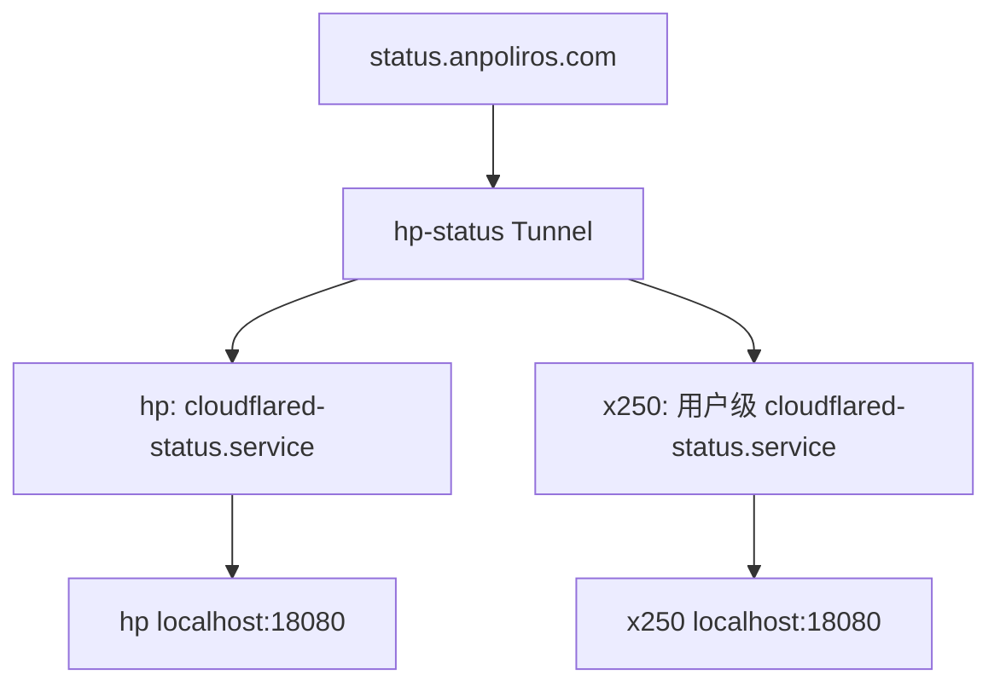

# Cloudflare 入口与 status 副本

2026-11-18 核验。所有 Tunnel 均由 Cloudflare 远程管理；路由配置使用 CF API 维护，connector 在主机上读取 token 加入对应 Tunnel。凭据不进入仓库。

## hp 上的三个 connector

| systemd 系统服务 | Tunnel | 发布域名与本地源站 |
| --- | --- | --- |
| cloudflared.service | hp-local | anpoliros.com → :1638；auth.anpoliros.com → :1639；git.anpoliros.com → :9173；vsss.anpoliros.com → :8888；blog.anpoliros.com → :12121 |
| cloudflared-ssh.service | hp-ssh | ssh.anpoliros.com → ssh://localhost:22 |
| cloudflared-status.service | hp-status | status.anpoliros.com → http://localhost:18080 |

三个 connector 均以专用 `cloudflared` 用户运行。hp 的 Mihomo TUN 对该 UID 配置绕过，新进程需要沿用该身份；status connector 同时沿用现有网站 connector 的 HTTP/2 传输设置。不要直接改为普通用户服务，否则可能出现 QUIC 超时或 TLS EOF。

每个 connector 通常建立四条到 Cloudflare 的连接，所以 hp 上是三个进程、三个 Tunnel 的 connector、正常共十二条连接。

## status 的跨主机入口

`hp-status` UUID：`3f9fe1be-2d4e-44f0-9e25-7e31eaae497b`。DNS 的代理 CNAME 指向该 UUID 的 `.cfargotunnel.com` 地址。旧 `hp-local` Tunnel 已移除 status 路由，继续承载其余五个网站。

两个 connector 共用同一条 ingress：`status.anpoliros.com → http://localhost:18080`。这里的 localhost 分别指 hp 和 x250；副本不要求两台机器能互相连接。

x250 原有 `X250` Tunnel 继续发布 `north.anpoliros.fun → http://localhost:80`，与 status 无关。因此 x250 上共两个 connector。

## 实例配置与运行

- hp：PM2 的 `status-worker`、`status-api`，配置 `configs/general.json`，`instance.name` 为 `hp`。pusr 仍是独立实例，名称 `hp-pusr`，不接入这个 Tunnel。
- x250：用户级 systemd 的 `status-worker`、`status-api`，配置 `configs/general.json`，`instance.name` 为 `x250`；服务与机器空闲采集 900 秒，机器活跃周期 60/120/300 秒。
- 两台 API 都监听 `127.0.0.1:18080`。x250 本机 exporter 由用户级 `status-node-exporter` 管理，仅监听 `127.0.0.1:9100`。
- 两边数据库、历史、会话各自独立。切换副本可能重新登录、看到不同历史；footer 标识当前展示数据来自哪个实例。
- hp token 文件：`/etc/cloudflared/hp-status.token`；x250 token 文件：`~/.config/cloudflared/hp-status.token`。均限制为 600 权限，通过 `--token-file` 加载。

检查方式：hp 使用 `systemctl status cloudflared-status`；x250 使用 `systemctl --user status cloudflared-status`。对应日志使用 `journalctl -u` 或 `journalctl --user -u`。不要在共享日志中输出 token。

GitHub 为 origin，Gitea 为另一个远端。x250 使用 HTTPS Gitea 远端抓取；本次 GitHub 连接超时，Gitea 更新成功。前端构建在 hp 完成，dist 同步到 x250。

## 可用性边界与验证

Cloudflare replicas 会按连接位置选路，不提供 hp 优先、均分或会话粘滞。connector 断线能触发连接切换；本地 API 失败而 connector 在线时可能返回 502，不能代替应用健康检查。

本次分别临时停止 hp、x250 的 status connector，验证公网匿名历史仍可由另一实例提供，随后恢复两个 connector。原有网站和 SSH connector 保持运行。

x250 所在 tailnet 中 hp 旧身份和 x253 离线；hp 当前地址从 x250 不可达。因此远端机器指标暂不可用，公网服务探测及 x250 本机采集独立运行。hp 本机的服务端口流量遥测未复制到 x250。

官方参考：[Tunnel 副本与选路](https://developers.cloudflare.com/cloudflare-one/networks/connectors/cloudflare-tunnel/configure-tunnels/tunnel-availability/)、[部署 replicas](https://developers.cloudflare.com/cloudflare-one/networks/connectors/cloudflare-tunnel/configure-tunnels/tunnel-availability/deploy-replicas/)。
